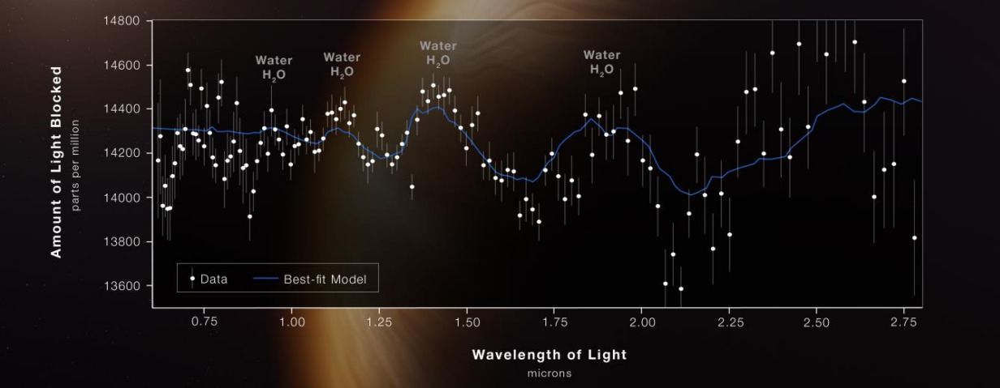

Tema elegido: Detectar si un planeta lejano tiene vapor de agua con el telescopio James.

El telescopio James Webb tiene un instrumento llamado espectrógrafo que descompone la luz en partes. La luz que sale de una estrella parece de un solo tono cuando la miramos nosotros, pero en realidad está compuesta por muchísimos "colores" mezclados, incluyendo varios que nuestros ojos no pueden ver. El espectrógrafo capta esa luz y la descompone en un enorme arcoíris, midiendo cuánta cantidad hay de cada color por separado. El telescopio incialmente mira una estrella y mide su luz y cuando un planeta pasa por delante de esa estrella, su atmósfera absorbe parte de esa luz en ciertas longitudes de onda, sobre todo en el infrarrojo. Dentro de este espectro está el infrarrojo, que tiene un rango limitado. Si miramos, dentro de ese rango, la parte de 1,4 micrómetros, vamos a ver una caída de luz. Nos damos cuenta de que hay una caída de luz porque medimos el brillo de la estrella antes del tránsito y durante el tránsito, y comparamos los dos valores. Gracias a esto, podemos crear un algoritmo que mira la caída de luz antes y durante el tránsito, confirma que esa absorción sea estadísticamente buena, y también valida que se repita en otra longitud de onda de respaldo, como 1,15 micrómetros, para asegurarse de que de verdad hay vapor de agua. Aun así, las nubes o las manchas de la estrellas pueden interferir en el proceso y por eso la detección se expresa con un nivel de confianza.

Importante: los valores 1,4 y 1,15 µm son las longitudes de onda donde la molécula de agua absorbe luz infrarroja, y se conocen por mediciones de laboratorio. Las moleculas de agua no puede absorber luz de cualquier color. Solo absorbe fotones cuya energía coincide exactamente con la diferencia entre dos estados de energía permitidos de la molécula. Esos estados están cuantizados, así que hay "escalones" fijos, y cada molécula tiene su propio conjunto de escalones. Eso es lo que hace que cada molécula tenga una huella única, como si fuera un código de barras.

 
Fuente: https://assets.science.nasa.gov/content/dam/science/missions/webb/science/2022/07/STScI-01HBE0FT2QWXNCY9DZGHZY6S7K.pdf

```
INICIO

  LEER mediciones (brillo de la estrella por longitud de onda y por tiempo)
  DEFINIR umbral = valor mínimo de diferencia

  SEPARAR mediciones en:
      fuera_transito
      durante_transito

  PARA CADA longitud_onda HACER
      brillo_fuera  = PROMEDIO(fuera_transito en esa longitud_onda)
      brillo_durante = PROMEDIO(durante_transito en esa longitud_onda)
      caida[longitud_onda] = brillo_fuera - brillo_durante
  FIN PARA

  // Banda principal
  diferencia_1 = caida[1.4] - caida[1.3]
  SI diferencia_1 > umbral ENTONCES
      senal_principal = VERDADERO
  SINO
      senal_principal = FALSO
  FIN SI

  // Banda de respaldo
  diferencia_2 = caida[1.15] - caida[1.3]
  SI diferencia_2 > umbral ENTONCES
      senal_respaldo = VERDADERO
  SINO
      senal_respaldo = FALSO
  FIN SI

  // Decisión final
  SI senal_principal Y senal_respaldo ENTONCES
      MOSTRAR "Se detectó con alto nivel de confianza la presencia de vapor de agua"
  SINO
      MOSTRAR "Resultado no concluyente"
  FIN SI

FIN
```


